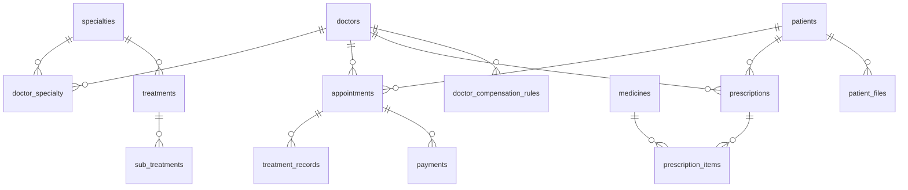

# Cavity Care Pro → Laravel: Migration & Expansion Plan

_Written 2026-11-20 from the live repo (`D:\Apps\Cavity\cavity-care-pro`, Supabase project `eokqbyokqanoueyxlhiq`)._
_The older copy in `D:\Apps\Dentest-app\cavity-care-pro` is **not** reused. At most, glance at it for ideas._

---

## 0. Where we are today (what the plan is based on)

| Area | Current state | Problem |
|---|---|---|
| Backend | Supabase (Postgres + Auth + RLS + 1 edge function), no server code | All business logic runs in the browser: many separate client calls, not atomic, hard to audit |
| Tables | `patients, doctors, appointments, treatments, sub_treatments, sub_treatment_steps, treatment_records, treatment_plans, appointment_treatment_steps, unfinished_sub_treatments, payments, waiting_list, activity_logs, profiles, user_roles, role_permissions` | Built only for dentistry: `treatment_records.tooth_number` is NOT NULL, specialty is a free-text field on `doctors.specialty` |
| Money | Cost is stored on `treatment_records.actual_cost_syp/usd`. Payments are tied to `appointment_id`, so the doctor is only reachable through the appointment. Totals are added up **in the browser** (`SystemStatistics.tsx`, `PatientProfile.tsx`) | No specialty dimension, no doctor share. It slows down as data grows, and different numbers on different screens are possible |
| Independent doctor | `doctors.has_own_books` + RESTRICTIVE RLS (migration `20261119120000`) | Has to be re-implemented as Laravel policies/scopes |
| سجل النشاطات | Generic Postgres trigger dumps the whole row as JSON (`details.old_data/new_data`). The page shows `action` + JSON | Unreadable for staff, so nobody uses it |
| العلاجات الجارية | Separate page (`OngoingTreatments.tsx`, 650 lines) listing incomplete `treatment_records` | Nobody uses it. The data behind it (multi-session progress) **is** still needed |
| Realtime | Waiting list display uses Supabase realtime channels | Shared hosting can't run websockets |
| Frontend | React + Vite + shadcn, RTL Arabic. `Appointments.tsx` is 3,350 lines, `PatientProfile.tsx` is 1,694 | Hard to change safely |

---

## 1. Target architecture

**Recommendation: Laravel 12 API + keep the existing React frontend.** The UI already works and staff know it. We swap its data layer (Supabase client → our API), so we don't rewrite every screen in Blade/Inertia.

```
https://your-domain/            → React build (public_html), unchanged hosting
https://your-domain/api/*       → Laravel (code outside public_html, /api routed to laravel/public)
```

- **Host (confirmed):** PHP 8.3, MySQL (managed with phpMyAdmin), SSH access, cron jobs, 50 GB disk. Composer runs over SSH, so there is no need to upload `vendor/`.
- **Laravel 12 on MySQL.** Keep all existing **UUID primary keys** (`HasUuids`, stored as `char(36)`) so every ID survives the migration.
- **Auth:** Laravel Sanctum, SPA cookie mode (same domain, no tokens in localStorage). Supabase password hashes are bcrypt (`$2a$`), and PHP verifies those natively, so **users keep their current passwords**.
- **Authorization (built in Phase A):** one `users.role` column (Supabase had one role per user, so spatie/laravel-permission isn't needed), a role matrix in `backend/config/clinic.php` ported from the RLS role policies, and Laravel **Policies + `visibleTo()` query scopes** backed by `App\Support\DoctorBooks`, which re-implements `can_see_doctor_books` / `can_see_doctor_schedule` / `can_read_treatment_catalog` exactly. The `role_permissions` table is kept for the UI toggles.
- **Packages:** `spatie/laravel-activitylog` (new activity log), `spatie/laravel-backup` (daily DB + files backup), `intervention/image` (thumbnails for x-rays), `spatie/laravel-query-builder` (filter/sort/paginate endpoints), Pest for tests.
- **Shared-host constraints:** no websockets → waiting list uses polling every 5 s (React Query `refetchInterval`). Queue uses the `database` driver. One cron entry runs `php artisan schedule:run` for backups and cleanup.
- **Code layout:** `app/Models`, `app/Http/Controllers/Api`, `app/Http/Requests` (validation), `app/Http/Resources` (JSON shape), `app/Services` (business logic: `AppointmentCompletionService`, `BillingService`, `PrescriptionService`), `app/Policies`.

---

## 2. New & changed data model



### 2.1 التخصصات (Specialties)

| Table | Columns |
|---|---|
| `specialties` | `id, name_ar, name_en, code, is_dental (bool), color, sort_order, is_active, timestamps` |
| `doctor_specialty` | `doctor_id, specialty_id, is_primary` (confirmed: a doctor can have more than one; one is primary) |

**Initial seed (confirmed):**
- **طب الأسنان** (`is_dental = true`): every current doctor and the whole current treatment catalog.
- **طب الأطفال** (`is_dental = false`): for the children's doctor. It starts with a simple catalog such as **معاينة وفحص**, with no teeth and no multi-step sub-treatments. A single price is enough.

For non-dental specialties the treatment form is simplified: no tooth chart and no steps. A treatment can have a single default sub-treatment, which the UI hides.

Changes to existing tables:
- `doctors.specialty` (text) → replaced by the pivot. The old text is kept as `legacy_specialty` until verified.
- `treatments.specialty_id` **required**. The treatment catalog screen gets a specialty filter, and a doctor only sees treatments of their own specialties when recording.
- `sub_treatments.tooth_association` is **only shown when the specialty `is_dental`**. Non-dental treatments are always `not_related` and the tooth picker is hidden.
- `treatment_records.tooth_number` → **nullable** (non-dental records store `NULL`, not an empty string).
- `appointments.specialty_id`: which specialty this visit is for (defaults to the doctor's primary). It is needed when a doctor has two specialties.

### 2.2 Money by doctor and specialty

Principle: **every money row carries its own `doctor_id` and `specialty_id` snapshot**, so reports are a single `GROUP BY`. No joins through appointments, and reports stay correct even if a doctor's specialty changes later.

- `treatment_records` + `doctor_id`, `specialty_id`, `patient_id` (filled on create and back-filled during migration).
- `payments` + `doctor_id`, `specialty_id`, `patient_id`, `method` (cash/transfer), `received_by` (user), `notes`. `appointment_id` **stays required** (confirmed: no payment without an appointment). The doctor and specialty are always copied from that appointment.
- **Patient balance** = Σ charges − Σ payments, per currency, **broken down per doctor/specialty**. Computed in SQL by `BillingService` and returned by one endpoint (`GET /patients/{id}/balance`). Every screen shows the same number.
- **Doctor percentage (confirmed: doctors are paid a percentage):**
  - `doctor_compensation_rules`: `doctor_id, specialty_id (nullable = all of the doctor's specialties), percent, effective_from, effective_to`. The basis is always **collected payments** (confirmed). **The percentage is set per doctor** (confirmed). Rules are dated, so changing a percentage never rewrites past months.
  - `doctor_payouts`: `doctor_id, period_from, period_to, amount, currency, paid_at, notes` (what the clinic actually paid the doctor).
- **Fixed charges (confirmed: rent, clinic materials…):**
  - `expense_categories`: إيجار، مواد، كهرباء، رواتب موظفين، مخبر… (editable list), each with a default allocation.
  - `expenses`: `category_id, amount, currency, spent_at, notes, allocation (clinic_wide | specialty | doctor), specialty_id nullable, doctor_id nullable, is_recurring`. Monthly rent can be generated automatically by a recurring entry.
  - Charges tied to one doctor (that doctor's materials or lab work) go **directly** to that doctor.
  - **Clinic-wide charges (rent, electricity, shared materials) are split by each doctor's work hours in the month** (confirmed). Example: Dr. A worked 120 h and Dr. B 40 h, so A carries 75% of the rent and B 25%.
- **Doctor attendance (new, needed for the split):**
  - `doctor_attendances`: `doctor_id, date, check_in, check_out, hours (computed), source (manual | schedule), entered_by, notes`.
  - Reception or the doctor records check-in/out from the dashboard with one click. The admin can correct entries, and every correction is logged in سجل النشاطات.
  - Optional `doctor_schedules` (weekly working days and hours) pre-fill the expected hours and flag missing check-ins.
  - Report: hours per doctor per day/month, used as the basis for allocating charges.
- **Settlement formula (confirmed: all charges are deducted first):**
  ```
  doctor_net_revenue = doctor's revenue
                     − direct charges of the doctor
                     − (clinic-wide charges × doctor's hours ÷ all doctors' hours)
  doctor_share       = doctor_net_revenue × doctor's percent
  clinic_share       = doctor_net_revenue − doctor_share
  ```
  Example: revenue 1,000,000, charges allocated to the doctor 300,000, 40% → (1,000,000 − 300,000) × 40% = **280,000** to the doctor.
  - If charges are larger than revenue in a month, the doctor's share is 0. The admin chooses whether the loss is carried into next month (setting, default: no).
  - Charges in USD and SYP are deducted from the matching currency.
- **Monthly settlement report, per doctor and per specialty:**
  `revenue` → `direct charges` → `allocated clinic charges (by hours)` → `net` → `doctor's share` → `clinic's share` → `already paid to doctor` → `still owed`, shown separately for SYP and USD. The month can be **closed** (locked) once paid, which freezes the figures.
- **Revenue reports (confirmed need):** per doctor, per specialty, and doctor × specialty, by day/month/year with Excel export. These ship in **Phase B** (go-live). Percentage, expenses and settlement ship in Phase G.
- Currency: keep **SYP and USD as separate ledgers** (same as today). Optionally add an `exchange_rates` table that is used only for display ("≈ total in USD"), never to rewrite stored amounts.
- `has_own_books` stays. An independent doctor's money is visible only to them + super_admin, enforced in the Policy and scope layer.

### 2.3 الأدوية والوصفات (Medicines & Prescriptions)

| Table | Columns |
|---|---|
| `medicines` | `id, trade_name, generic_name, form (tablet/syrup/drops/injection/cream…), strength, default_dose, default_frequency, default_duration, notes, specialty_id nullable, is_active` |
| `prescriptions` | `id, number (sequential, printed), patient_id, doctor_id, specialty_id, appointment_id nullable, diagnosis, notes, issued_at, printed_at` |
| `prescription_items` | `id, prescription_id, medicine_id nullable, medicine_name (snapshot), dose, frequency, duration, route, quantity, instructions, sort_order` |
| `prescription_templates` (+ items) | per doctor: "معالجة التهاب لثة", "خافض حرارة أطفال"… One click fills the prescription |

Flow: from the appointment dialog or patient profile, the doctor clicks **"وصفة طبية"**, searches medicines (autocomplete, can type a medicine that isn't in the list, which is saved by name), picks a template if wanted, then saves and prints.

**Printing (confirmed: A4, clinic logo + header, per-doctor header):** a dedicated React print page (`/print/prescription/:id`) with print CSS: A4 page, RTL, clinic logo/header, **a header per doctor** (`doctors.print_header`, `doctors.signature_image` optional), doctor name + specialty, patient name/age/date, medicines list, signature line, optional QR with the prescription number. Browser printing renders Arabic correctly. Server-side PDF libraries (dompdf) handle Arabic poorly, so we avoid them. The same print approach is reused for receipts and the patient statement.

### 2.4 ملفات المريض (Patient files / medical history)

| Table | Columns |
|---|---|
| `patient_files` | `id, patient_id, appointment_id nullable, uploaded_by, category (xray, radiology, lab_test, report, photo, prescription_scan, other), title, taken_at, notes, disk, path, original_name, mime, size, thumbnail_path, soft deletes` |

- Files live on a **private disk** (`storage/app/private/patients/{patient_id}/…`). They are never in `public_html`, and they are downloaded through an authorized controller that checks the policy.
- Upload limits: images/PDF/DICOM-exported JPG, max ~20 MB each (configurable). Phone camera upload works from the browser.
- Thumbnails are generated on upload. Images open in a viewer with zoom; files can be compared side by side (before/after x-ray).
- **Patient timeline ("السجل الطبي")**: one chronological view in the patient profile that merges visits, treatments done, prescriptions, files, and payments, filterable by specialty. This is the "historical history" you asked for.
- Disk: 50 GB is plenty (about 20,000 x-rays at ~2 MB each). The admin dashboard shows usage and warns at 80%. Backups include this folder; a full copy should also go off the server.

### 2.5 سجل النشاطات (rebuild, because the current one is unreadable)

Replace the "JSON dump" trigger with **human-readable events** written by the backend:

- Each event = who, what (an Arabic sentence), which patient, link, and a changed-fields table with Arabic field names and old → new values.
  - "سجّل د. أحمد دفعة **50,000 ل.س** للمريض **محمد علي**"
  - "عدّلت الاستقبال موعد **سارة** من 10:00 إلى 11:30"
  - "حذف المدير علاج **حشوة ضوئية** (السن 16) من موعد 2026-11-02"
- Only meaningful events are logged (create/edit/delete of appointments, treatments, payments, prescriptions, files, patients, users). Waiting-list noise and `updated_at` touches are skipped.
- Page: filters for user, patient, type, and date. Money changes and deletions are highlighted (that is where audits matter). An **"سجل التغييرات"** tab on each patient profile shows only that patient's history.
- Old logs: imported into `legacy_activity_logs`, read-only and available to the admin. They are not converted.

### 2.6 العلاجات الجارية (remove the page, keep the data)

- Delete the `/ongoing-treatments` page and its sidebar item.
- Keep the multi-session data (`unfinished_sub_treatments`, `appointment_treatment_steps`, incomplete records). Surface it where people already look:
  - patient profile: a small **"علاجات غير مكتملة"** card at the top
  - appointment dialog: "هذا المريض لديه علاج غير مكتمل: سحب عصب – السن 36 (خطوة 2/3)" with a "continue" button
  - optional: a dashboard counter for the doctor.

---

## 3. Backend improvements (beyond the move)

1. **Atomic operations.** Completing an appointment (records + steps + payment + plan update) becomes **one API call in one DB transaction**. Today it is several browser calls, and a lost connection can leave half-saved data.
2. **Server-side reports.** Statistics are computed with SQL `SUM … GROUP BY doctor, specialty, currency, month`, instead of downloading every record to the browser.
3. **Pagination and search** on patients, appointments, logs, and files.
4. **Validation** with FormRequests: unique patient phone (warning), no double-booking a doctor's time slot, no duplicate treatment on the same tooth in the same visit (already done in the UI, now enforced server-side).
5. **Soft deletes** for patients, doctors, treatments, payments, and files. Nothing financial is ever hard-deleted, and the admin can restore.
6. **Locking edits on old money.** Editing payments or records older than N days needs super_admin (configurable).
7. **Backups:** daily DB + patient files, keeping 14 days, with a copy sent off the server (Google Drive/S3 via `spatie/laravel-backup`).
8. **Security:** rate-limited login, password reset done by the admin (replaces the edge function), session timeout, HTTPS only, private file storage.
9. **Tests (Pest)** for the money rules, the independent-doctor visibility rules, and the import verification.
10. **API documentation** generated (Scribe), which also gives the frontend accurate types.

---

## 4. Frontend improvements

1. **Data layer:** add `src/api/` (axios client with Sanctum cookie + one hook per resource such as `usePatients` or `useCreatePayment`). Pages stop importing `supabase` directly. This is what makes the backend swap possible screen by screen.
2. **Split the giant pages:** `Appointments.tsx` → `AppointmentCalendar`, `AppointmentDialog`, `TreatmentRecordForm`, `PaymentForm`, `PlanExecution`. `PatientProfile.tsx` → tabs: overview, timeline, treatments, prescriptions, files, finance, log.
3. **Specialty everywhere:** a specialty chip/color on appointments, a specialty filter on calendar/treatments/reports, and the tooth chart only for dental.
4. **New screens:** التخصصات management, الأدوية catalog, وصفة editor + print, patient files tab + viewer, doctor finance (share/payouts), and finance reports by doctor × specialty × period with Excel export (xlsx is already a dependency).
5. **Dashboard per role:** reception gets today's queue + arrivals; doctor gets today's patients, incomplete treatments, and own revenue; admin gets revenue by specialty/doctor and owed balances.
6. **Global patient search** (Ctrl+K, by name/phone) from any page.
7. **Print layouts** with one style for prescriptions, payment receipts, and patient account statements.
8. **Sidebar cleanup:** remove العلاجات الجارية and group items as: الاستقبال / المرضى / الأطباء والتخصصات / المالية / الإعدادات.
9. **Consistency:** one number/currency formatter (`50,000 ل.س`, `$120`), Arabic dates everywhere, empty states, error boundary, loading skeletons, and mobile-friendly dialogs.

---

## 5. Data migration process (keeps all current data)

**Golden rules:** IDs never change. The import is **idempotent** (it can be re-run any number of times). Supabase stays untouched and intact until well after cutover, so you can always go back.

### Step 1: Snapshot & baseline
- Full `pg_dump` of the Supabase DB, **including the `auth` schema** (password hashes), stored off-site.
- Record a **baseline report**: row count per table, plus money totals per patient, per doctor, and per currency (charges and payments). This baseline is what we verify against.

### Step 2: Laravel schema
- Laravel migrations recreate every existing table with the same columns and UUIDs, plus the new columns and tables from §2.

### Step 3: Import command `php artisan import:supabase`
Reads directly from Supabase Postgres (second DB connection) in dependency order, and upserts by `id`:

| From | To / transformation |
|---|---|
| `auth.users` + `profiles` + `user_roles` | `users` (same id, email, bcrypt hash, full name) + spatie roles |
| `role_permissions` | spatie permissions |
| `doctors.specialty` text | ignored for mapping: **every current doctor → طب الأسنان** (confirmed). The old text is kept in `legacy_specialty` |
| `doctors` | `doctors` + `doctor_specialty` (primary = طب الأسنان); `user_id`, `has_own_books` kept |
| `treatments` | + `specialty_id` = طب الأسنان for every existing treatment. The children's catalog (معاينة وفحص…) is created fresh after go-live |
| `sub_treatments`, `sub_treatment_steps` | as-is (non-dental → `tooth_association = not_related`) |
| `patients`, `appointments`, `waiting_list` | as-is; `appointments.specialty_id` from the doctor's primary specialty |
| `treatment_records` | + `doctor_id`, `patient_id` (from appointment), `specialty_id` (from treatment); empty/placeholder `tooth_number` → NULL |
| `payments` | + `doctor_id`, `patient_id`, `specialty_id` (from appointment) |
| `treatment_plans`, `appointment_treatment_steps`, `unfinished_sub_treatments` | as-is |
| `activity_logs` | **not imported** (decision 2026-11-21: exported to Excel by the clinic and cleared; the new log starts empty) |

Where the import runs: check over SSH whether the host's PHP has `pdo_pgsql` (`php -m | grep pgsql`) and can reach Supabase on port 5432. If yes, run the import on the host. If not, run it on your PC (Laravel + MySQL), then `mysqldump` and import the dump with phpMyAdmin or the `mysql` command over SSH. The result is the same.

### Step 4: Automatic verification `php artisan import:verify`
- Row counts match the baseline table by table.
- **Every patient's balance (SYP and USD) matches to the last digit.** Totals per doctor and per currency match.
- No orphaned rows (every record has an appointment, every payment has a doctor).
- Login test with 2–3 real accounts using their existing passwords.
- The import is "done" only when this command reports zero differences.

### Step 5: Staging trial
- Deploy to `staging.your-domain` with a fresh copy of the data. Staff use it for a few days for normal tasks (book, treat, pay, print) while the live system stays on Supabase.

### Step 6: Cutover (one evening, ~1–2 hours)
1. Show a maintenance banner and put Supabase in read-only (revoke write policies; the rollback SQL is prepared in advance).
2. Run `import:supabase` (final full re-run, since data volume is small), then `import:verify`.
3. Deploy the frontend build that points to `/api`.
4. Smoke test: login per role, open patients, add a test payment and delete it.

### Step 7: Rollback & retirement
- Rollback: redeploy the previous frontend build and re-enable Supabase writes. **Keep Supabase intact for 30 days** after cutover.
- After 30 days with no issues: take a final Supabase dump to archive, then pause the project.

---

## 6. Delivery phases

| Phase | Content | Why this order |
|---|---|---|
| **A. Foundation** ✅ 2026-11-20 | Laravel project in `backend/`, auth (Sanctum + existing passwords), roles/policies incl. independent doctor, `src/api` layer in React. 19 PHPUnit tests passing (SQLite) | Everything depends on it |
| **B. Parity + specialties** | All current features over the API, **specialties + money snapshots** in the schema, **revenue reports per doctor/specialty**, import + verify commands, remove العلاجات الجارية page | The money model must be right **at import time**, so specialties belong here, not later |
| **C. Cutover** | Staging trial → go-live → 30-day safety window | Live on Laravel with no new risk |
| **D. Activity log rebuild** ✅ 2026-11-21 | Readable events (appointments, treatments, payments, plans, patients, doctors, users, price list, specialties, role permissions), filters, "money and deletions" view, patient سجل التغييرات (admin) | Small, quick win after go-live |
| **E. Prescriptions** ✅ 2026-11-22 | Medicines catalog (الأدوية), prescriptions with sequential numbers, per-doctor templates, A4 print page with clinic + doctor header, print settings (logo, name, address, footer) | Independent module |
| **F. Patient files & timeline** ✅ 2026-11-23 | Private uploads (x-rays, lab tests, reports, photos, PDF) with thumbnails, viewer with zoom/rotate, before/after compare, السجل الطبي timeline with specialty filter, storage usage card | Needs storage/backup proven first |
| **G. Finance v2** | Doctor attendance (check-in/out, hours), per-doctor percentage rules, fixed charges split by work hours, monthly settlement + month closing, doctor payouts. Attendance capture can start earlier (in B) so hours exist when settlement goes live | Needs a few weeks of clean specialty data. Can move before E/F if settlement is more urgent |
| **H. Children's doctor** | Seed طب الأطفال catalog (معاينة وفحص…), create the doctor's login, own books if wanted | Possible any time after go-live; it is configuration, not new code |

New features are **not** built on Supabase first, so nothing has to be written twice.

---

## 7. Risks & how they're handled

| Risk | Mitigation |
|---|---|
| Money totals drift during import | `import:verify` per-patient balance check; go-live is blocked until it reports zero differences |
| Users locked out | bcrypt hashes migrated; admin password reset available from day one |
| Shared host limits (no websockets) | SSH, Composer, cron and 50 GB are confirmed; waiting list uses polling instead of websockets |
| Independent-doctor privacy regressions | Pest tests that copy every RLS rule in `20261119120000_independent_doctors.sql` |
| Staff confusion after the switch | Same UI and screens; only cleanup + new features. A short change list in Arabic at go-live |

---

## 8. What gets deleted / retired
- `/ongoing-treatments` page (data kept, surfaced in patient profile + appointment dialog)
- Old JSON activity log trigger and page (archived as `legacy_activity_logs`)
- `admin-reset-password` edge function (moves to a Laravel endpoint)
- `@supabase/supabase-js`, `src/integrations/supabase/*`, and the `express` dependency (unused in the SPA)

---

## 9. Decisions (answered 2026-11-20)
1. **Host:** PHP 8.3, MySQL + phpMyAdmin, SSH, cron jobs, 50 GB disk.
2. **Doctor money:** doctors are paid a **percentage**. There are fixed charges (rent, clinic materials). Revenue reports are needed per doctor and per specialty.
3. A doctor **can have more than one specialty**.
4. Prescriptions print on **A4** with clinic logo and header, and each doctor has their own header.
5. Every current doctor is a **dentist**. A **children's doctor** comes later, with simple treatments such as **معاينة وفحص**.
6. **No payment without an appointment.**

7. **All charges are deducted first**, then the percentage: (1,000,000 − 300,000 charges) × 40% = 280,000.
8. The **percentage differs per doctor**, and **clinic-wide charges are split by each doctor's attendance / work hours**.

9. The percentage is calculated on **payments actually collected** in the month (by `paid_at`), not on treatment prices charged. A debt counts toward the doctor only in the month the patient pays it.

10. Each doctor's **percentage is fixed** and edited by the admin. Hours are used only to split clinic-wide charges, never to change the percentage.

All open questions are answered. The plan is ready for Phase A.
